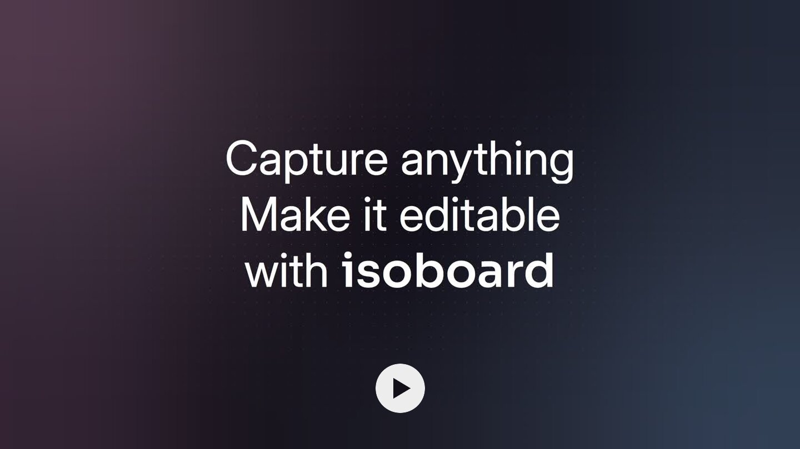

<h1 align="center">
  <a href="https://isoboard.app">
    <picture>
      <source media="(prefers-color-scheme: dark)" srcset="docs/public/media/lockup-white.svg">
      <source media="(prefers-color-scheme: light)" srcset="docs/public/media/lockup-black.svg">
      
    </picture>
  </a>
</h1>

<p align="center">
  Capture anything on your screen and paste it as rich text, tables and images.
</p>

<p align="center">
  <a href="https://github.com/carlesonielfa/isoboard-app/actions/workflows/ci.yml"></a>
  <a href="LICENSE.md"></a>
</p>

<p align="center">
  <a href="https://isoboard.app/#demo"></a>
</p>

<p align="center">
  <a href="https://isoboard.app">isoboard.app</a> ·
  <a href="https://docs.isoboard.app">Documentation</a> ·
  <a href="https://isoboard.app/download">Download</a>
</p>

isoboard is a macOS menu bar app. Press a shortcut, select a region of your screen, and paste the result into another app. Text, tables, styling and embedded images come through as content you can edit.

## Features

- **Capture from the menu bar.** Select any region with a global shortcut.
- **Paste rich results.** The result lands on your clipboard as formatted text and tables you can paste into apps like Word.
- **Profiles.** Save a model, conversion options and Additional Rules together, and capture with any of them from the menu bar.
- **Local or your own provider.** Run isOCR™, our fine-tuned OCR model, on your Mac, or connect OpenAI, Anthropic, Gemini or an OpenAI-compatible server such as Ollama or LM Studio.
- **History.** Recent results stay on your Mac so you can copy them again without running the model.

With the local isOCR model, captures stay on your device. See [what data leaves your Mac](https://docs.isoboard.app/privacy/data/).

## Requirements

- macOS 14 Sonoma or later on a Mac with Apple silicon.
- Windows and Linux are coming, prioritized by demand.

## Install

1. Download the DMG from [isoboard.app](https://isoboard.app).
2. Drag isoboard to **Applications** and open it. The setup guide covers permissions and the local model.

isoboard is free for personal use. Work use needs a commercial license after a seven-day evaluation. See [pricing and licensing](https://docs.isoboard.app/license/pricing-and-licensing/).

## Documentation

- [User documentation](https://docs.isoboard.app)
- [Troubleshooting](https://docs.isoboard.app/troubleshooting/capture-and-permissions/)
- [Privacy and your data](https://docs.isoboard.app/privacy/data/)
- [Developer documentation](https://docs.isoboard.app/developers/)

## Build from source

You need macOS 14 or later, [Bun](https://bun.sh), Rust with Cargo, the [Tauri prerequisites](https://v2.tauri.app/start/prerequisites/), Xcode or its Command Line Tools, and CMake (`brew install cmake`).

```bash
git clone https://github.com/carlesonielfa/isoboard-app.git
cd isoboard-app
make install
make dev
```

`make dev` runs the app as **isoboard Dev** with its own configuration and data. The [setup guide](https://docs.isoboard.app/developers/setup/) covers signing, permissions, tests and packaging.

## Contributing

Pull requests are welcome. Read [CONTRIBUTING.md](CONTRIBUTING.md) first. Contributors keep ownership of their work and accept the [Contributor Agreement](CONTRIBUTOR-AGREEMENT.md) once, in a pull request comment. Report security issues as described in [SECURITY.md](SECURITY.md).

## License

isoboard uses a custom [source-available license](LICENSE.md). Personal use and development are free, work use needs a commercial license after the evaluation, and selling copies or offering the app as a hosted service needs a separate written agreement. It is not an OSI-approved open source license. The [commercial terms](src-tauri/legal/COMMERCIAL-TERMS.md) apply to paid licenses.

Third-party software and model weights keep their own licenses. See [THIRD_PARTY_NOTICES.txt](THIRD_PARTY_NOTICES.txt) and the [releases and notices guide](https://docs.isoboard.app/developers/releases-and-notices/).
