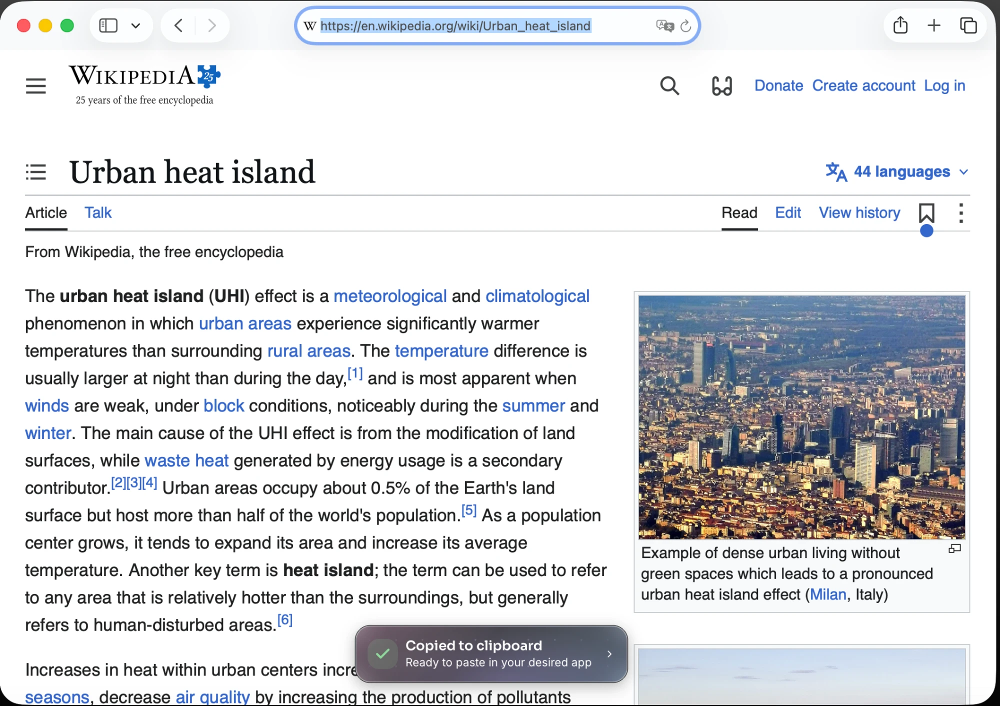

import BeforeAfter from '../../../components/BeforeAfter.astro';
import recipeSource from '../../../assets/examples/recipe-source.png';
import recipeResult from '../../../assets/examples/recipe-result.png';

{/* os:macos: shortcuts, permissions and the menu bar on this page are macOS-specific. */}

To make your first capture, finish the setup guide, press **⌘ Cmd** + **⇧ Shift** + **2**, drag over part of your screen and paste with **⌘ Cmd** + **V**. The setup guide handles the license choice, Screen Recording permission and the model. Downloading isOCR™ takes the longest, about 1 GB.

## What do I need before I start?

- isoboard installed. See [install isoboard](../install/).
- A Mac with macOS 14 Sonoma or later.
- An internet connection for the isOCR download, or an API key for an [AI provider](../../models/choose-a-model/).

## How do I finish the setup guide?

The settings window opens by itself the first time you launch isoboard. If it does not, click the isoboard icon in the menu bar.

{/* os:macos */}
1. **Choose how you will use isoboard.** Select **Continue without a license key** to start a seven-day commercial evaluation. Personal, non-commercial use stays free afterward. If you already have a key, select **Activate commercial license**. See [pricing and licensing](../../license/pricing-and-licensing/).
2. **Allow Screen Recording.** Select **Ask macOS for access**, turn on isoboard in System Settings, and return. Select **Continue** when the card shows **Allowed**. Notifications are optional. See [grant macOS permissions](../permissions/).
3. **Set up AI Model.** Choose one of two paths:
   - **Download isOCR™** runs on your Mac, needs no account and works offline afterward. Select the download button, wait for **Verifying** to finish, then select **Continue**. You can switch to other apps while it downloads. See [run isOCR](../../models/local-models/).
   - **I’ll use an external LLM provider** opens the **Providers** tab. Add your API key for [OpenAI](../../models/openai/), [Anthropic](../../models/anthropic/), [Gemini](../../models/gemini/) or an [OpenAI-compatible server](../../models/openai-compatible/), then select **Continue**.
4. **Start capturing.** isoboard opens the **Shortcuts** tab and shows your capture shortcut. The **Capture** button at the top right glows. Select **Done**.

:::tip
If you are unsure which path to take, start with isOCR. You can add a provider later and keep both. See [choose a local model or an AI provider](../../models/choose-a-model/).
:::

The progress bar at the top of the guide shows **Permissions**, **Set up AI Model** and **Start capturing**. A **Model** step appears only when the guide cannot fill in a working Profile for you.

## How do I make the capture?

{/* os:macos */}
1. Open the page, document or image you want to copy from, for example a table in a PDF.
2. Press **⌘ Cmd** + **⇧ Shift** + **2**. You can also select the **Capture** button in the isoboard window, or choose **Capture region** from the menu bar menu. See [use isoboard from the menu bar](../../use/menu-bar/).
3. Drag over the area you want. Press **Esc** to cancel.
4. Release the mouse button. A small overlay appears with **Region captured**, then **Processing capture**.
5. Wait for **Copied to clipboard** and **Ready to paste in your desired app**.

The first conversion with isOCR shows **Loading model** while the model starts. Later captures are faster.

## How do I paste the result?

Switch to the app where you want the content and press **⌘ Cmd** + **V**. Tables, formatting and images paste as rich content in apps that accept it. Other apps receive plain text. See [paste results into other apps](../../use/paste/).

<BeforeAfter
  before={recipeSource}
  beforeAlt="A brownie recipe header on a website, with a photo, title, author and prep times."
  after={recipeResult}
  afterAlt="The same recipe pasted into a Google Slides slide, with the photo, bold title and labeled times."
/>

## What if something goes wrong?

- **Nothing happens when I press the shortcut.** Setup may be incomplete. The footer shows **Setup incomplete** until permission, a Profile and a model are ready. See [shortcuts problems](../../troubleshooting/shortcuts/).
- **The overlay says Capture failed.** Click the overlay to open the failed entry in **History**, where the error is shown. See [fix AI provider errors](../../troubleshooting/provider-errors/) or [capture and permission problems](../../troubleshooting/capture-and-permissions/).
- **The pasted result lost its formatting, tables or images.** Not every app accepts everything isoboard copies, and some need a specific paste option. In Microsoft Word, for example, choose **Keep Source Formatting** when you paste. See [which apps support isoboard results](../../use/paste/#which-apps-support-isoboard-results).
- **The result is not what I expected.** With a provider connected, try its **Accurate** Profile, or change what the Profile keeps. See [set up Profiles](../../use/profiles/).

## What should I do next?

- Change the shortcut under the **Shortcuts** tab. See [keyboard shortcuts](../../reference/keyboard-shortcuts/).
- Add [Additional Rules](../../use/additional-rules/) to translate or reformat what you capture.
- Review earlier captures in [History](../../use/history/).

## Related

- [Capture part of your screen](../../use/capture/)
- [Paste results into other apps](../../use/paste/)
- [Set up Profiles](../../use/profiles/)
