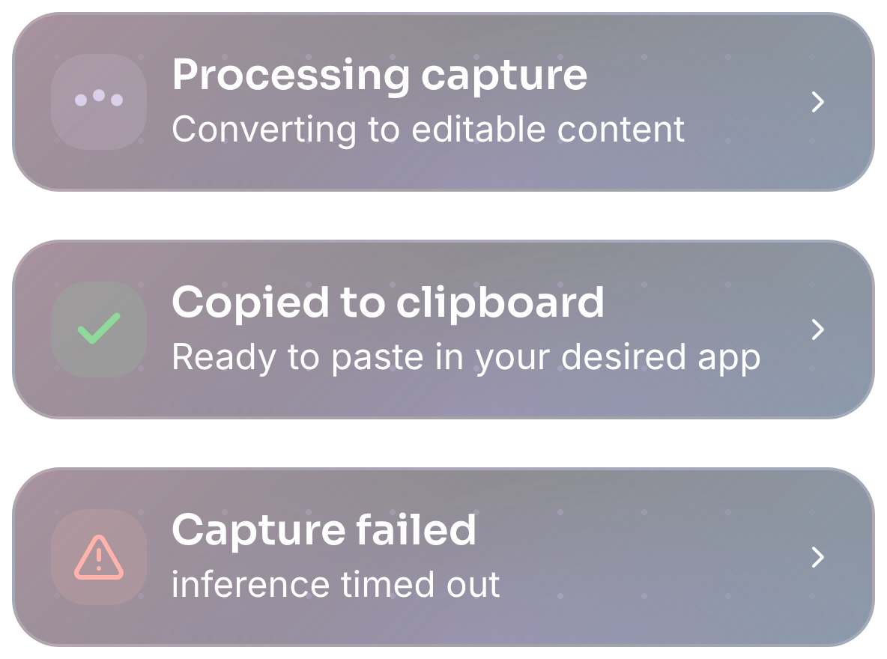

<!-- os:macos: shortcuts, the menu bar and the capture picker are macOS-specific. -->

To capture, press **⌘ Cmd** + **⇧ Shift** + **2**, drag over the part of your screen you want and release. isoboard converts the region with the active Profile and puts a pasteable result on your clipboard. You can also start a capture from the **Capture** button in the isoboard window or from the menu bar.

## How do I start a capture?

<!-- os:macos -->
| Method | How |
|---|---|
| Shortcut | Press **⌘ Cmd** + **⇧ Shift** + **2**. You can change it in the **Shortcuts** tab. |
| Capture button | Select **Capture** at the top right of the isoboard window. It shows the name of the active Profile. The window hides while you select. |
| Menu bar | Choose **Capture region** from the isoboard menu bar menu. See [use isoboard from the menu bar](../menu-bar/). |
| Profile shortcut | Press a shortcut you assigned to a specific Profile. See below. |

Each method uses a Profile. The shortcut, the button and **Capture region** use the active Profile. A Profile shortcut always uses its own Profile and leaves the active one unchanged.

Capture is unavailable until setup is complete. The footer shows **Setup incomplete**, **Screen access required**, **Profile needs attention** or **Shortcut unavailable** when something blocks it. See [make your first capture](../../getting-started/first-capture/).

## How do I select a region?

<!-- os:macos -->
After you start a capture, macOS shows its region picker.

1. Drag over the area you want to convert.
2. Release to capture. isoboard starts processing at once.

To cancel, press **Esc** before you release. A cancelled selection leaves your clipboard, History and files unchanged and shows no error.

A very small selection is also treated as a cancel, so an accidental click does nothing.

## What happens after I select a region?

A small overlay appears on the display where you finished selecting:

1. **Region captured**, then **Processing capture**.
2. If a local model is not downloaded or loaded yet, **Downloading model** or **Loading model**.
3. **Copied to clipboard** when the result is ready to paste, or **Capture failed** with the reason.

The overlay stays out of your way. Hover over it to keep it on screen, and move away to let it close. Click it to open the related entry in [History](../history/). A success message closes quickly. An error stays longer.

<!-- os:macos -->
The menu bar icon animates while a capture is processing, and its menu shows the latest status. See [use isoboard from the menu bar](../menu-bar/).

## How do I move or hide the overlay, or turn off sounds?

1. Open the **Settings** tab → **Capture status**.
2. Set **Position**. You can choose one of nine places on the screen. The default is bottom center.
3. Turn **Show capture status** off to hide the overlay. The menu bar icon, sounds and History still report each result.
4. To silence the capture sounds, including error sounds, turn **Play sounds** off in **General**.

## How do I assign a shortcut to a specific Profile?

Profile shortcuts let you run a capture with a given Profile without switching the active one, for example one shortcut for plain extraction and another for translation.

1. Open the **Shortcuts** tab. **Profile shortcuts** appears once you have more than one Profile.
2. Choose a Profile in the new-shortcut row at the end of the list.
3. Select the shortcut field and press the key combination you want.

To change a shortcut, select it and press a new combination. Press **Esc** or click away to keep the current one. If a combination conflicts with another one, isoboard keeps the last working shortcut. To remove a Profile shortcut, select its trash button. Deleting a Profile also deletes its shortcut. The default **Capture region** shortcut always follows the active Profile and cannot be deleted. See [keyboard shortcuts](../../reference/keyboard-shortcuts/).

## Can isoboard capture any app?

Almost. isoboard needs Screen Recording permission. Some apps and protected content, such as streaming video, block screen capture and appear blank, so isoboard cannot read them. See [capture and permission problems](../../troubleshooting/capture-and-permissions/).

## Can I capture while another capture is running?

No. isoboard handles one capture at a time. **Capture region** in the menu is disabled while a capture is in progress, and the button and shortcuts wait until it finishes.

## Frequently asked questions

**Where does the captured image go?**

With a local model, it stays on your Mac. With an AI provider, isoboard sends it to that provider. History keeps a small thumbnail of every capture and, unless you turn it off, the original screenshot of your 50 most recent captures. See [what leaves your Mac](../../privacy/data/).

**Why did my capture say Capture failed?**

The overlay shows the reason. Common causes are missing Screen Recording permission, a model that is not ready, or a provider error. Click the overlay to see the full message in History. See [fix AI provider errors](../../troubleshooting/provider-errors/).

## Related

- [Paste results into other apps](../paste/)
- [Set up Profiles](../profiles/)
- [Keyboard shortcuts](../../reference/keyboard-shortcuts/)
