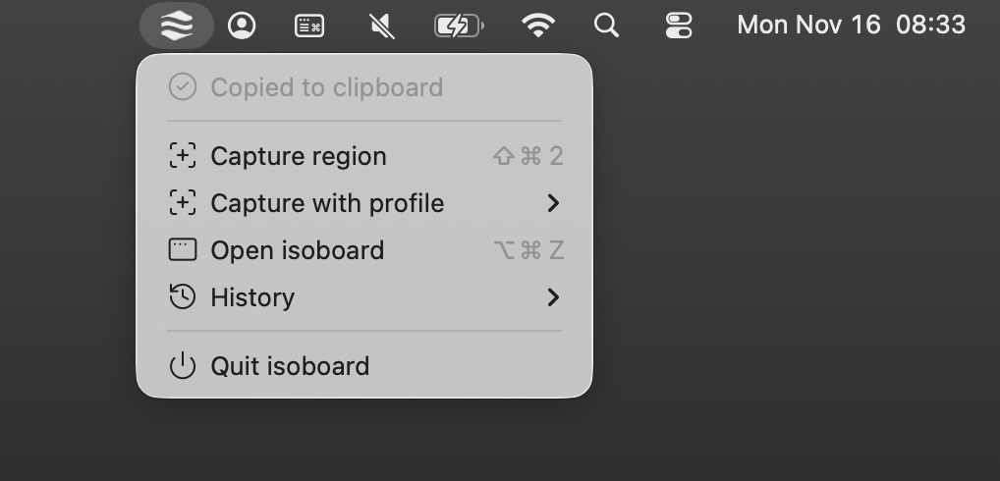

<!-- os:macos: the menu bar is a macOS feature. Windows and Linux will use the system tray, and this page needs a sibling section. -->

isoboard lives in the macOS menu bar. Click its icon to open the settings window. Open its menu to start a capture, copy one of your five most recent results or quit. The icon animates while isoboard processes a capture, and its tooltip and status row show what is happening.

## How do I open the isoboard menu?

<!-- os:macos -->
- Click the isoboard icon to open and focus the isoboard window.
- Right-click the icon to open the menu.

The window shortcut, **⌘ Cmd** + **⌥ Option** + **Z** by default, also opens and focuses the window. Closing the window hides it and keeps isoboard running. To quit, use **Quit isoboard** in the menu.

## What does each menu item do?

| Item | What it does |
|---|---|
| Status row (top, greyed out) | Shows the latest capture status. See the table below. |
| **Capture region** | Starts a capture with the active Profile. Shows your capture shortcut. Disabled while a capture runs or setup is incomplete. |
| **Capture with profile** | A submenu of your Profiles. Select one to capture with it once. The active Profile, marked with a checkmark, stays the same. |
| **Open isoboard** | Opens and focuses the isoboard window. Shows the window shortcut. |
| **History** | A submenu of your five most recent successful results. Select one to copy it back to the clipboard. |
| **View all history** | Opens the **History** tab, including failed attempts. |
| **Quit isoboard** | Quits isoboard. |

Each **History** entry shows its capture time, with a date if it was captured before today, and the start of its text. Failed and pending captures do not appear here. See [History](../history/).

A Profile in **Capture with profile** is greyed out until it is ready, for example while its model is missing or its provider is not connected. To change the active Profile, use the isoboard window. See [set up Profiles](../profiles/).

## What do the status messages mean?

The status row and the icon's tooltip use the same words:

| Status | Meaning |
|---|---|
| No capture in progress | isoboard is ready |
| Select a region | Waiting for you to drag over the screen |
| Downloading model · 42% | A local model is downloading, with its progress |
| Loading model | A local model is starting |
| Processing image | The model is working |
| Copied to clipboard | The result is ready to paste |
| Capture cancelled | You cancelled the capture |
| Screen access needed | Screen Recording permission is missing. See [permissions](../../getting-started/permissions/). |
| Provider failed | The AI provider returned an error. See [fix AI provider errors](../../troubleshooting/provider-errors/). |
| Clipboard failed | isoboard could not write to the clipboard |
| Capture failed | Another capture error. Open **History** for the message. |

The icon animates while a capture is processing and stays plain otherwise. Click the capture overlay, or open **View all history**, to see the details of a failure.

## How do I start isoboard automatically?

Turn on **Open at login** in the **Settings** tab → **General**. isoboard then starts in the menu bar with its window hidden. See [grant macOS permissions](../../getting-started/permissions/#open-at-login-on-macos).

## Frequently asked questions

**Why is Capture region greyed out?**

A capture is running, or setup is incomplete. Check the footer in the isoboard window for **Setup incomplete**, **Screen access required**, **Profile needs attention** or **Shortcut unavailable**. See [capture and permission problems](../../troubleshooting/capture-and-permissions/).

**I closed the window. Is isoboard still running?**

Yes. Closing the window hides it. The menu bar icon stays, and your shortcuts keep working. Choose **Quit isoboard** to stop it.

## Related

- [Capture part of your screen](../capture/)
- [History](../history/)
- [Grant macOS permissions](../../getting-started/permissions/)
