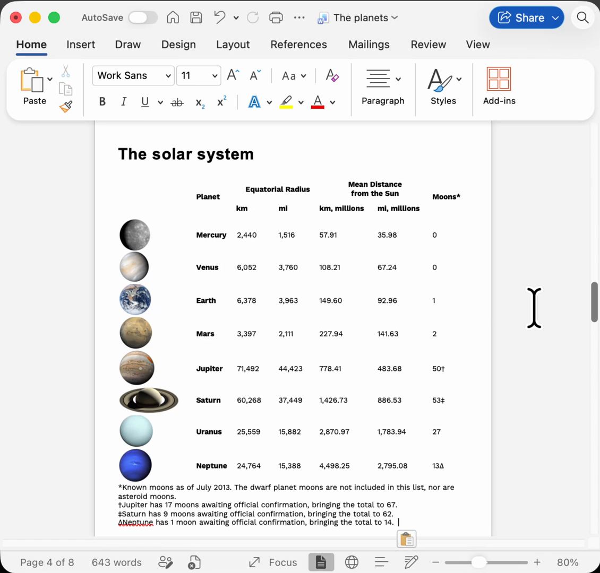

A Profile is a saved setup for captures. It holds the model that reads the image, which elements to keep (Tables, Colors and Images) and optional Additional Rules. Create one Profile for everyday captures and another for translation, then switch between them or give each its own shortcut.

## What does a Profile contain?

| Section | What it controls |
|---|---|
| **Name** | The label shown on the **Capture** button and in lists. Must be unique within your Profiles. |
| **Conversion** | Which elements to keep: **Tables**, **Colors** and **Images**. |
| **Model** | The provider and model that convert the image. |
| **Rules** | [Additional Rules](../additional-rules/) and the model that applies them. |

All Profiles share your provider keys and downloaded local models. A Profile stores which model to use, not any credentials.

## How do I create, duplicate or delete a Profile?

1. Open the **Profiles** tab.
2. Select the plus button (**Add profile**) below the list to create one, and give it a name.
3. To copy an existing Profile, open the menu next to it and choose **Duplicate**. The copy opens with its name selected so you can rename it.
4. To remove one, open the menu and choose **Delete**.

You cannot delete your last Profile. Deleting a Profile also deletes any capture shortcut assigned to it. Changes save automatically.

## How do I switch the active Profile?

The active Profile is the one the **Capture** button, the default capture shortcut and **Capture region** use. It is marked in the list.

- Select a Profile in the **Profiles** tab. This also makes it the active Profile.
- Open the dropdown on the **Capture** button and choose a Profile under **Capture with profile...**. This changes the active Profile without starting a capture.

To run one capture with a different Profile without switching, choose it under **Capture with profile** in the [menu bar menu](../menu-bar/), or assign it its own shortcut. See [capture part of your screen](../capture/).

## What do Tables, Colors and Images do?

All three are on by default. Turn one off to simplify the result. A small preview next to the switches shows the effect.

| Option | When it is off |
|---|---|
| **Tables** | Table rows become lines of text, with spaces between cells. The text and formatting inside each cell stay. Merged cells are written once, and captions and reading order stay. |
| **Colors** | Color styling is removed. The content and all other formatting stay. |
| **Images** | Image regions are left out. The text and captions around them stay. Text printed inside an omitted image is not transcribed in its place. |

You can also change these options on a saved result without capturing again. See [History](../history/).

## What does Conversion settings application do?

**Conversion settings application** is an Advanced mode setting. It decides how isoboard applies Tables, Colors and Images. Most people leave it on **Automatic**.

| Option | What happens |
|---|---|
| **Automatic** | isoboard picks the approach, which is **Prompt + cleanup** for every model. |
| **Prompt only** | The options are sent to the model as instructions. |
| **Cleanup only** | The model gets no extra instructions. isoboard removes the unwanted elements from the result afterward. |
| **Prompt + cleanup** | Both. |

The setting does not apply to Additional Rules.

Advanced mode also shows the **Conversion prompt template** and the model's temperature, maximum output and timeout. Most captures need none of them. To switch modes, use **Basic**, **Advanced** or **Debug** in the footer. Hiding Advanced settings does not reset them.

## Which Profiles come with isoboard?

- **Default.** The Profile you start with. Setup fills it with isOCR when you choose the local model.
- **Efficient** and **Accurate** Profiles for each provider you connect. Connecting OpenAI, Anthropic or Gemini adds two Profiles named after the provider, for example **Anthropic - Efficient** and **Anthropic - Accurate**.

| Built-in Profile | Use it for |
|---|---|
| **Efficient** | Faster, lower-cost everyday captures |
| **Accurate** | Difficult captures. It may take longer and cost more. |

The model picker marks these two choices with a lightning icon (Efficient) and a bulb icon (Accurate). Hover over an icon to see the trade-off. OpenAI-compatible servers add no Profiles because you choose their model yourself.

Built-in Profiles are ordinary Profiles. You can rename, edit and delete them. isoboard creates them once per provider and never recreates a Profile you deleted. Removing a provider key does not delete its Profiles. See [choose a local model or an AI provider](../../models/choose-a-model/).

## How do I choose the model for a Profile?

1. Open the **Profiles** tab and select the Profile.
2. In **Model**, set **Provider** to **Local** or to a connected provider.
3. Pick a model. For the local model, select **isOCR1 0.8B** and download it if needed.

If no provider is connected, the **Provider** field points you to the **Providers** tab. A Profile that cannot run shows a red reason in the list, and the footer shows **Profile needs attention**. See [run isOCR](../../models/local-models/) and [OpenAI](../../models/openai/), [Anthropic](../../models/anthropic/), [Gemini](../../models/gemini/) or [OpenAI-compatible servers](../../models/openai-compatible/).

## When does a change to a Profile apply?

On the next capture. Editing a Profile during a capture does not affect that capture.

## Frequently asked questions

**How many Profiles can I have?**

You need at least one. isoboard sets no upper limit.

**Can two Profiles use different models?**

Yes. Each Profile chooses its own model. One can use isOCR and another an AI provider.

**Where are Profiles stored?**

In `config.toml`, so you can edit or share them. See [the configuration file](../../reference/configuration-file/).

## Related

- [Additional Rules](../additional-rules/)
- [Capture part of your screen](../capture/)
- [Choose a local model or an AI provider](../../models/choose-a-model/)
